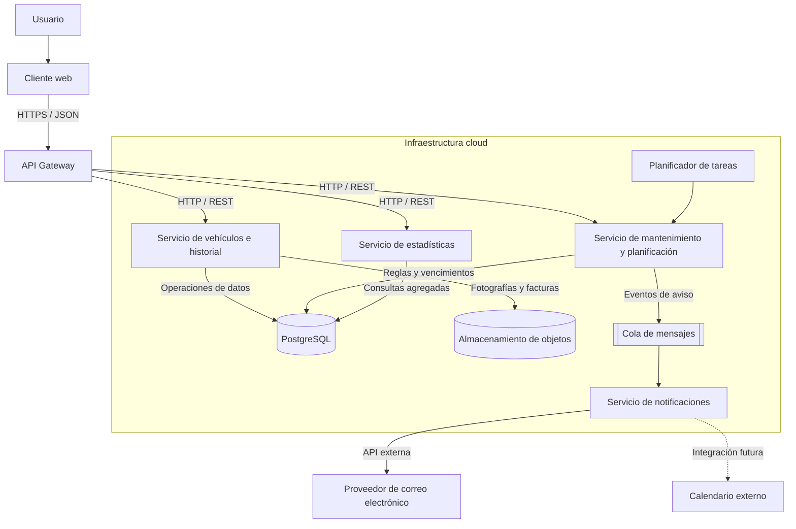

# 🚗 MiGaraje — Gestión inteligente del mantenimiento de vehículos

**Autora:** Mercedes Lorenzo Aragón  
**Asignatura:** Cloud Computing: Fundamentos e Infraestructuras  
**Titulación:** Máster Universitario en Ingeniería Informática  
**Curso académico:** 2026-2027  
**Universidad:** Universidad de Granada (UGR)

---

## 1. Descripción del proyecto

### 1.1. Contexto y problemática

El mantenimiento de un vehículo requiere realizar numerosas tareas a lo largo de su vida útil: cambios de aceite y filtros, revisiones de frenos y neumáticos, sustitución de líquidos, inspecciones técnicas periódicas (ITV) y reparaciones de distinta naturaleza.

En muchos casos, los propietarios gestionan esta información de forma manual, mediante facturas en papel, notas, hojas de cálculo o recordatorios independientes. Esta dispersión dificulta conocer el historial completo del vehículo, recordar cuándo corresponde realizar cada mantenimiento y calcular cuánto dinero se ha invertido en su conservación.

Además, cuando se sustituye una pieza o se realiza una reparación, puede resultar complicado recuperar información como la marca y el modelo del componente utilizado, el taller responsable, el precio pagado o el kilometraje en el momento de la intervención.

Estas dificultades pueden provocar olvidos, retrasos en las revisiones, gastos imprevistos y una menor capacidad para planificar el mantenimiento de los vehículos.

### 1.2. Solución propuesta

**MiGaraje** es una aplicación web cloud-native destinada a la gestión integral de vehículos personales y la planificación de su mantenimiento.

La aplicación permitirá centralizar la información de uno o varios vehículos, conservar su historial de intervenciones, programar tareas periódicas, generar recordatorios automáticos y analizar los gastos asociados a su mantenimiento.

Su principal valor diferencial será la combinación de un historial técnico estructurado con un sistema de planificación que permita estimar cuándo debe realizarse cada tarea, tanto en función del tiempo transcurrido como del kilometraje recorrido.

Por ejemplo, un usuario podrá consultar cuándo realizó el último cambio de aceite, qué producto utilizó, cuánto costó y cuándo debería realizar el siguiente. La aplicación también podrá generar avisos anticipados de una ITV próxima, registrar una reparación con sus facturas y consultar el gasto anual de cada vehículo.

El sistema se diseñará mediante una arquitectura distribuida de microservicios independientes, desplegables en contenedores y preparados para ejecutarse en una infraestructura cloud.

### 1.3. Objetivo general

Diseñar e implementar una aplicación cloud-native basada en microservicios que facilite la gestión de vehículos personales mediante la centralización de su información, la planificación automatizada de mantenimientos, el envío de notificaciones y el análisis de gastos.

### 1.4. Objetivos específicos

- Permitir el registro y la gestión de múltiples vehículos por usuario.
- Mantener un historial cronológico de reparaciones, revisiones y sustituciones de componentes.
- Planificar mantenimientos recurrentes mediante fechas y umbrales de kilometraje.
- Detectar tareas próximas a vencer y tareas cuyo plazo ya se ha superado.
- Automatizar el envío de recordatorios por correo electrónico y facilitar su integración con calendarios externos.
- Registrar los costes de piezas, mano de obra y servicios de taller.
- Generar estadísticas mensuales y anuales de gastos por vehículo y categoría.
- Desarrollar servicios independientes, contenerizados y desplegables en la nube.
- Aplicar principios de seguridad, persistencia, escalabilidad y observabilidad propios de una aplicación cloud-native.

---

## 2. Funcionalidades principales

### 2.1. Gestión del garaje

El usuario podrá registrar tantos vehículos como necesite, incluyendo coches, motocicletas, furgonetas y otros vehículos personales.

Para cada vehículo se almacenarán los siguientes datos:

- Tipo de vehículo, marca, modelo y año.
- Matrícula opcional y fecha de matriculación.
- Tipo de combustible y kilometraje actual.
- Fotografía, características técnicas y notas personales.

La aplicación permitirá consultar, actualizar y eliminar vehículos, así como acceder a su información de mantenimiento y gastos.

### 2.2. Historial de reparaciones e intervenciones

Cada vehículo dispondrá de un historial cronológico de las operaciones realizadas.

Cada registro podrá incluir:

- Fecha y kilometraje de la intervención.
- Categoría y descripción del trabajo realizado.
- Pieza sustituida, marca, modelo y referencia del producto.
- Taller o proveedor del servicio.
- Coste de las piezas y coste de la mano de obra.
- Coste total, observaciones y documentación adjunta.

Este historial permitirá recuperar información de intervenciones anteriores sin tener que volver a investigar los productos utilizados o los precios pagados.

### 2.3. Planificación de mantenimientos

La aplicación permitirá configurar tareas periódicas, como cambios de aceite, sustitución de filtros, revisión de frenos, comprobación de neumáticos o sustitución de líquidos.

Cada tarea podrá definirse mediante:

- Tipo de mantenimiento y descripción.
- Intervalo temporal, expresado en días, meses o fechas objetivo.
- Intervalo de kilometraje.
- Fecha y kilometraje de la última realización.
- Fecha y kilometraje estimados para la siguiente intervención.
- Anticipación de los recordatorios y estado de la tarea.

El sistema calculará los vencimientos a partir de las reglas configuradas y los datos disponibles del vehículo.

Cuando una tarea dependa tanto del tiempo como del kilometraje, se considerará próxima a vencer si se aproxima cualquiera de los dos límites. Si se supera alguno de ellos, se marcará como vencida.

Las recomendaciones de mantenimiento serán configurables y deberán contrastarse con las indicaciones del fabricante de cada vehículo.

### 2.4. Calendario y notificaciones

La aplicación ofrecerá una vista global de las tareas programadas para todos los vehículos del usuario.

Entre sus funcionalidades se incluirán:

- Consulta de tareas pendientes, próximas, vencidas y completadas.
- Recordatorios configurables con anticipaciones de tres meses, un mes, una semana o un día.
- Avisos específicos para la ITV y otras fechas relevantes.
- Notificaciones por correo electrónico.
- Preparación de eventos para su incorporación a calendarios externos.
- Registro del estado de los avisos para evitar envíos duplicados.

La planificación se realizará mediante procesos programados que comprobarán periódicamente los vencimientos. Las notificaciones se generarán únicamente cuando se cumplan las condiciones establecidas para cada tarea.

### 2.5. Gastos y estadísticas

MiGaraje permitirá conocer el coste económico asociado al mantenimiento de cada vehículo.

Se contemplarán las siguientes consultas:

- Gastos mensuales y anuales.
- Coste total por vehículo.
- Distribución de gastos por categoría de intervención.
- Evolución de los costes a lo largo del tiempo.
- Comparación de gastos entre vehículos del mismo usuario.
- Consulta de los importes asociados a piezas, mano de obra y servicios externos.

Las estadísticas se calcularán a partir de los registros económicos del historial, evitando mantener duplicados innecesarios de los mismos importes.

---

## 3. Modelo de negocio y propuesta de valor

### 3.1. Usuarios objetivo

MiGaraje estará orientado principalmente a particulares que poseen uno o varios vehículos y desean organizar su mantenimiento de forma sencilla.

En una posible evolución futura, la aplicación podría ampliarse para ofrecer funcionalidades a pequeños negocios con flotas reducidas.

### 3.2. Propuesta de valor

La propuesta de valor se fundamenta en cuatro aspectos:

1. **Centralización:** toda la información técnica, económica y documental de los vehículos estará disponible en un único lugar.
2. **Prevención:** los recordatorios ayudarán a reducir los olvidos y a anticipar las tareas de mantenimiento.
3. **Trazabilidad:** el usuario podrá recuperar el historial de reparaciones, productos y precios.
4. **Control económico:** las estadísticas facilitarán la comprensión y planificación de los gastos asociados a cada vehículo.

### 3.3. Modelo de explotación potencial

Como hipótesis de negocio, la aplicación podría ofrecer un modelo *freemium*:

- **Plan gratuito:** gestión de un número limitado de vehículos, historial y recordatorios básicos.
- **Plan prémium:** varios vehículos, mayor capacidad de almacenamiento documental, notificaciones avanzadas, integraciones con calendarios y estadísticas ampliadas.

Este modelo permitiría estudiar la viabilidad económica de la solución en una futura evolución. No constituye una funcionalidad obligatoria de la primera versión del proyecto.

---

## 4. Arquitectura de referencia

### 4.1. Enfoque arquitectónico

MiGaraje se diseñará siguiendo una arquitectura de microservicios. Cada servicio tendrá una responsabilidad funcional delimitada, una API propia y la posibilidad de desplegarse de forma independiente.

La solución estará preparada para ejecutarse mediante contenedores Docker y desplegarse en una plataforma cloud.

La arquitectura propuesta contempla inicialmente los siguientes componentes:

1. **API Gateway:** punto de entrada para los clientes. Centralizará el acceso a las API internas y podrá aplicar autenticación, validación de solicitudes y límites de consumo.
2. **Servicio de vehículos e historial:** gestionará los vehículos, las intervenciones realizadas, las piezas utilizadas, los costes y los documentos asociados.
3. **Servicio de mantenimiento y planificación:** gestionará las reglas de periodicidad, calculará vencimientos y mantendrá el estado de las tareas.
4. **Servicio de notificaciones:** procesará los recordatorios pendientes y coordinará el envío de correos electrónicos y las futuras integraciones con calendarios.
5. **Servicio de estadísticas:** ofrecerá consultas agregadas sobre gastos, categorías y evolución temporal.
6. **Capa de persistencia:** almacenará los datos de negocio y los estados necesarios para la ejecución fiable de los procesos.
7. **Almacenamiento de archivos:** conservará fotografías y documentos, como facturas, mediante un servicio de almacenamiento de objetos.

El API Gateway es un componente de entrada y no un microservicio de negocio adicional. Los servicios de estadísticas y notificaciones podrán incorporarse progresivamente, manteniendo como prioridad una primera versión realista y funcional.

### 4.2. Tecnologías propuestas

| Componente | Tecnología propuesta | Finalidad |
|---|---|---|
| Lenguaje | Python | Desarrollo de la lógica de negocio |
| API REST | FastAPI | Exposición de endpoints y validación de datos |
| Validación | Pydantic | Validación de solicitudes y modelos de datos |
| Contenedores | Docker | Empaquetado y aislamiento de servicios |
| Persistencia principal | PostgreSQL | Almacenamiento de vehículos, intervenciones, tareas y gastos |
| Acceso a datos | SQLAlchemy | Interacción con la base de datos |
| Comunicación síncrona | HTTP/REST y JSON | Comunicación entre clientes y servicios |
| Procesamiento asíncrono | Cola de mensajes, por ejemplo RabbitMQ | Desacoplamiento de tareas y notificaciones |
| Tareas programadas | APScheduler o un mecanismo equivalente | Comprobación periódica de vencimientos |
| Archivos | Almacenamiento de objetos compatible con S3 o equivalente cloud | Fotografías y facturas |
| Despliegue | Docker Compose en desarrollo y plataforma de contenedores cloud en producción | Ejecución local y despliegue distribuido |
| Control de versiones | Git y GitHub | Gestión del código y colaboración |
| Pruebas | pytest | Verificación de la lógica de negocio y de las API |

Estas tecnologías constituyen una propuesta inicial de referencia y podrán ajustarse según los requisitos de implementación y los recursos disponibles.

### 4.3. Comunicación entre componentes

La comunicación entre clientes y servicios se realizará mediante API REST sobre HTTP/HTTPS, utilizando JSON como formato de intercambio.

Las operaciones que necesiten una respuesta inmediata, como consultar un vehículo o registrar una intervención, utilizarán comunicación síncrona.

Los procesos que puedan ejecutarse de manera independiente, como el envío de recordatorios, podrán utilizar una cola de mensajes. De esta forma, la creación de una tarea no dependerá directamente de que el proveedor de correo electrónico esté disponible en ese instante.

Por ejemplo, cuando se aproxime el vencimiento de una tarea:

1. El servicio de mantenimiento comprobará la fecha objetivo y el kilometraje registrado.
2. Si se cumplen las condiciones de aviso, generará un evento o un registro de notificación pendiente.
3. El servicio de notificaciones procesará el aviso.
4. Se intentará enviar el correo electrónico y se registrará el resultado.
5. En caso de fallo temporal, el sistema podrá reintentar el envío de acuerdo con una política definida.

El procesamiento deberá contemplar la deduplicación de avisos para evitar que un mismo recordatorio se envíe repetidamente.

### 4.4. Persistencia y propiedad de los datos

La solución utilizará PostgreSQL como base de datos relacional principal. La separación lógica de los servicios se reflejará en sus responsabilidades y en las interfaces de acceso a los datos.

En una arquitectura de microservicios más madura, cada servicio de negocio debería controlar sus propios datos y evitar las escrituras directas de otros servicios sobre sus tablas.

Para mantener un alcance viable en el proyecto académico, se podrá comenzar con una única instancia de PostgreSQL y esquemas o estructuras lógicas delimitadas por servicio. Esta decisión simplifica el despliegue inicial, aunque no equivale a disponer de bases de datos físicamente independientes.

Las comunicaciones entre servicios deberán realizarse a través de sus API o mecanismos de mensajería, sin depender de modificaciones directas en las tablas internas de otro servicio.

Las fotografías y facturas se almacenarán en un servicio de objetos. En la base de datos se conservarán sus metadatos y referencias, evitando guardar archivos binarios de gran tamaño en los registros de negocio.

### 4.5. Despliegue y escalabilidad

Durante el desarrollo se utilizarán contenedores Docker y Docker Compose para ejecutar los servicios y sus dependencias en un entorno reproducible.

En producción, los contenedores podrán desplegarse en una plataforma cloud gestionada. La selección concreta del proveedor y del servicio se realizará durante las siguientes fases del proyecto.

La arquitectura permitirá escalar los componentes de forma diferenciada. Por ejemplo, el servicio de notificaciones podría aumentar su número de instancias cuando exista una acumulación de recordatorios, mientras que el servicio de vehículos podría mantener una capacidad menor si su demanda es estable.

La base de datos, el almacenamiento documental y los servicios de terceros se tratarán como dependencias que requieren configuración, protección de credenciales, monitorización y políticas de recuperación.

---

## 5. Justificación según NIST SP 800-145

El documento NIST SP 800-145 define la computación en la nube mediante cinco características esenciales. MiGaraje aprovechará estas características mediante el despliegue de sus servicios en una infraestructura cloud y la automatización de su operación.

Referencia: Mell, P. y Grance, T. (2011). *The NIST Definition of Cloud Computing*. NIST Special Publication 800-145.

### 5.1. Autoservicio bajo demanda (*On-demand self-service*)

Los usuarios podrán registrar vehículos, configurar tareas de mantenimiento y modificar sus preferencias sin intervención manual del administrador de la aplicación.

Desde el punto de vista de la infraestructura, el despliegue automatizado de los contenedores y la provisión de recursos mediante los mecanismos del proveedor cloud permitirán reducir la intervención operativa necesaria para poner en funcionamiento nuevas instancias.

La característica se materializará especialmente en la automatización de despliegues y configuración, no únicamente en las operaciones que el usuario realice dentro de la aplicación.

### 5.2. Acceso amplio a la red (*Broad network access*)

La aplicación se ofrecerá mediante interfaces web y API accesibles a través de protocolos de red estándar.

Los usuarios podrán consultar el estado de sus vehículos y sus mantenimientos desde distintos dispositivos, como ordenadores, tabletas o teléfonos móviles, siempre que dispongan de conexión y credenciales válidas.

El acceso remoto facilitará la consulta del historial y de los recordatorios sin depender del dispositivo en el que se registró la información.

### 5.3. Asignación común de recursos (*Resource pooling*)

La infraestructura cloud permitirá compartir recursos de procesamiento, red y almacenamiento entre los distintos componentes de la aplicación.

La solución se diseñará para atender a múltiples usuarios manteniendo el aislamiento lógico de sus datos. Cada usuario únicamente podrá consultar y modificar los vehículos y registros para los que tenga autorización.

El proveedor cloud podrá administrar y asignar los recursos físicos subyacentes de forma compartida, mientras que la aplicación organizará los datos y las operaciones por usuario.

### 5.4. Rápida elasticidad (*Rapid elasticity*)

Los microservicios podrán escalar de forma independiente en función de la demanda.

Por ejemplo, si aumentase el número de usuarios o se acumulasen numerosos recordatorios, podrían desplegarse instancias adicionales de los servicios correspondientes, siempre que la plataforma de ejecución y la configuración implementada lo permitan.

Esta capacidad permitirá adaptar los recursos a las necesidades reales, evitando mantener permanentemente una infraestructura dimensionada para los picos máximos de utilización.

En la implementación académica, esta característica se podrá demostrar mediante el despliegue de varias instancias y pruebas de escalado, si los recursos del proveedor elegido lo permiten.

### 5.5. Servicio medido (*Measured service*)

La infraestructura cloud permitirá monitorizar el consumo de recursos, como CPU, memoria, almacenamiento, tráfico de red y número de instancias ejecutadas.

Estos datos facilitarán evaluar el rendimiento de los servicios y estimar el coste de funcionamiento de MiGaraje.

Además, la aplicación registrará métricas operativas, como recordatorios procesados, errores de envío, duración de solicitudes y volumen de operaciones.

La medición del consumo de infraestructura se distinguirá de las estadísticas económicas de los vehículos: ambas son útiles, pero responden a objetivos diferentes.

La primera permite controlar el coste de operar la aplicación; la segunda permite al usuario conocer el coste de mantener sus vehículos.

### 5.6. Modelo de servicio cloud

La solución se plantea principalmente como **Software as a Service (SaaS)** desde la perspectiva del usuario final: el consumidor utilizará la aplicación sin tener que administrar sus servidores o contenedores.

Desde la perspectiva del desarrollo, se utilizarán servicios de plataforma y, potencialmente, infraestructura proporcionados por un proveedor cloud. La clasificación concreta dependerá de los servicios contratados y de las responsabilidades asumidas por el proveedor.

### 5.7. Modelo de despliegue

Como primera opción se contempla una nube pública, utilizando servicios gestionados de ejecución de contenedores, bases de datos y almacenamiento.

Este modelo permite reducir la carga de administración de la infraestructura y facilita el aprovisionamiento de recursos. No obstante, la selección final deberá tener en cuenta los límites gratuitos, los costes de operación, las políticas de seguridad y las condiciones de disponibilidad del proveedor.

---

## 6. Actores del modelo de referencia NIST SP 500-292

El NIST SP 500-292 establece cinco actores principales en su arquitectura de referencia: consumidor, proveedor, intermediario, auditor y operador de transporte (*cloud carrier*).

En MiGaraje se identifican de la siguiente manera.

### 6.1. Consumidor de servicios cloud (*Cloud Consumer*)

El consumidor principal será el propietario del vehículo que utiliza MiGaraje para gestionar su garaje, registrar intervenciones, consultar estadísticas y recibir avisos.

Desde la perspectiva de los servicios cloud, el consumidor utilizará la aplicación como servicio SaaS.

**Impacto económico:** podrá beneficiarse de una mayor planificación del mantenimiento y de una mejor visibilidad de sus gastos. Estos beneficios son potenciales y dependerán del uso que realice de la aplicación.

### 6.2. Proveedor de servicios cloud (*Cloud Provider*)

El proveedor cloud será la empresa que proporcione la infraestructura o los servicios gestionados donde se ejecutará MiGaraje.

Podrá ofrecer recursos de computación, redes, almacenamiento de objetos, bases de datos gestionadas y monitorización.

**Impacto económico:** el uso de servicios gestionados puede reducir la inversión inicial en infraestructura propia y trasladar parte del coste a un modelo variable según consumo, aunque será necesario vigilar los gastos de ejecución, almacenamiento, tráfico y servicios adicionales.

### 6.3. Intermediario cloud (*Cloud Broker*)

En la primera versión, MiGaraje no necesitará un intermediario cloud independiente. La aplicación se conectará directamente a los servicios del proveedor seleccionado.

En una evolución futura, podría incorporarse un componente o servicio de intermediación para coordinar varios proveedores, seleccionar servicios equivalentes o facilitar una gestión centralizada de recursos de distintas nubes.

Un API Gateway no constituye por sí mismo un *cloud broker* según el modelo NIST, ya que su función principal es gestionar el acceso a las API de la aplicación.

**Impacto económico:** un intermediario podría ayudar a comparar precios y reducir la dependencia de un proveedor, aunque también introduciría costes de integración y operación.

### 6.4. Auditor cloud (*Cloud Auditor*)

El auditor cloud será la entidad o función independiente que evalúe la seguridad, el rendimiento, las operaciones y los controles de la infraestructura o de los servicios utilizados.

En el contexto académico, estas funciones se aproximarán mediante pruebas de seguridad, revisión de configuraciones, análisis de registros, comprobaciones de acceso y evaluación de disponibilidad.

Estas actividades no convierten automáticamente al desarrollador en un auditor independiente; representan controles internos de calidad y seguridad.

**Impacto económico:** las auditorías y las medidas de seguridad pueden suponer un coste adicional, pero ayudan a identificar riesgos, prevenir incidentes y mejorar la confianza en el servicio.

### 6.5. Operador de transporte cloud (*Cloud Carrier*)

El operador de transporte será el proveedor de conectividad que permita la comunicación entre los usuarios y los servicios cloud, mediante redes y protocolos de transporte.

En el escenario propuesto, la conexión se realizará a través de Internet y de los servicios de conectividad utilizados por el usuario y el proveedor cloud.

**Impacto económico:** la conectividad condiciona la accesibilidad y el rendimiento del servicio. También pueden existir costes de transferencia de datos asociados a la infraestructura seleccionada.

### 6.6. Resumen del mapeo de actores

| Actor NIST | Aplicación en MiGaraje | Situación inicial |
|---|---|---|
| Consumidor | Usuario que gestiona sus vehículos | Directo |
| Proveedor | Proveedor de la infraestructura y los servicios cloud | Previsto |
| Intermediario | Coordinación de servicios de varios proveedores | No necesario inicialmente |
| Auditor | Evaluación independiente de seguridad, rendimiento y controles | Posible externo; pruebas internas durante el desarrollo |
| Operador de transporte | Conectividad entre clientes y servicios cloud | Internet y proveedores de red |

Referencia: Liu, F. et al. (2011). *NIST Cloud Computing Reference Architecture*. NIST Special Publication 500-292.

---

## 7. Diagrama de arquitectura

El siguiente diagrama representa la arquitectura lógica de referencia prevista para MiGaraje. Describe los componentes y sus relaciones; no implica que todos estén implementados en la primera entrega.



### 7.1. Interpretación del diagrama

- El cliente web será el punto de interacción con el usuario.
- El API Gateway centralizará las solicitudes entrantes.
- El servicio de vehículos e historial gestionará la información de los vehículos y las intervenciones.
- El servicio de mantenimiento calculará los vencimientos y las tareas pendientes.
- El planificador activará las comprobaciones periódicas.
- La cola de mensajes desacoplará la generación de avisos de su envío.
- El servicio de notificaciones se comunicará con proveedores externos de correo electrónico.
- El servicio de estadísticas calculará los indicadores económicos.
- PostgreSQL almacenará los datos estructurados y el almacenamiento de objetos conservará las fotografías y facturas.

En la configuración inicial de MiGaraje se utilizará una única instancia de PostgreSQL para simplificar el despliegue y el desarrollo del proyecto. Los microservicios mantendrán responsabilidades e interfaces diferenciadas, de modo que cada uno gestione la lógica de negocio correspondiente a su dominio. Esta configuración inicial no implica que cada microservicio disponga de una base de datos independiente, aunque la arquitectura podrá evolucionar hacia una mayor separación de la persistencia si las necesidades del proyecto lo requieren.

---

## 8. Especificación inicial de las API REST

Las siguientes rutas constituyen una propuesta inicial para definir las interfaces del sistema. Los endpoints podrán evolucionar durante la implementación.

Se utilizará JSON como formato de intercambio y los recursos estarán protegidos mediante autenticación y autorización según corresponda.

### 8.1. Servicio de vehículos e historial

| Método | Endpoint | Descripción |
|---|---|---|
| GET | `/api/v1/vehicles` | Obtener los vehículos del usuario autenticado |
| POST | `/api/v1/vehicles` | Registrar un vehículo |
| GET | `/api/v1/vehicles/{vehicle_id}` | Consultar un vehículo |
| PATCH | `/api/v1/vehicles/{vehicle_id}` | Modificar los datos de un vehículo |
| DELETE | `/api/v1/vehicles/{vehicle_id}` | Eliminar un vehículo según las reglas de integridad definidas |
| GET | `/api/v1/vehicles/{vehicle_id}/records` | Consultar el historial de intervenciones |
| POST | `/api/v1/vehicles/{vehicle_id}/records` | Registrar una reparación o revisión |
| GET | `/api/v1/vehicles/{vehicle_id}/records/{record_id}` | Consultar una intervención concreta |

Ejemplo de solicitud para registrar un vehículo:

```json
{
  "type": "car",
  "brand": "Toyota",
  "model": "Corolla",
  "year": 2021,
  "registration": "1234ABC",
  "fuel_type": "hybrid",
  "current_mileage": 45000,
  "registration_date": "2021-06-15",
  "notes": "Uso principalmente urbano"
}
```

Ejemplo de solicitud para registrar una intervención:

```json
{
  "date": "2026-10-10",
  "mileage": 45000,
  "category": "oil_change",
  "description": "Cambio de aceite y filtro",
  "part": {
    "brand": "Ejemplo",
    "model": "Aceite 0W-20"
  },
  "workshop": "Taller de referencia",
  "parts_cost": 45.00,
  "labor_cost": 25.00,
  "currency": "EUR"
}
```

Los valores de los ejemplos son ficticios y se utilizarán únicamente para ilustrar la estructura de las solicitudes.

### 8.2. Servicio de mantenimiento y planificación

| Método | Endpoint | Descripción |
|---|---|---|
| GET | `/api/v1/vehicles/{vehicle_id}/maintenances` | Consultar los mantenimientos de un vehículo |
| POST | `/api/v1/vehicles/{vehicle_id}/maintenances` | Crear una regla de mantenimiento |
| GET | `/api/v1/maintenances/{maintenance_id}` | Consultar una tarea |
| PATCH | `/api/v1/maintenances/{maintenance_id}` | Modificar su configuración |
| GET | `/api/v1/maintenances/upcoming` | Consultar tareas próximas a vencer |
| GET | `/api/v1/maintenances/overdue` | Consultar tareas vencidas |
| POST | `/api/v1/maintenances/{maintenance_id}/complete` | Registrar la realización de una tarea |
| GET | `/api/v1/calendar/events` | Obtener los eventos de mantenimiento del usuario |

Ejemplo de solicitud para configurar un mantenimiento:

```json
{
  "vehicle_id": "veh_123",
  "name": "Cambio de aceite",
  "interval_months": 12,
  "interval_km": 15000,
  "last_completed_date": "2026-01-10",
  "last_completed_mileage": 40000,
  "reminder_offsets_days": [90, 30, 7, 1]
}
```

Los intervalos del ejemplo son ilustrativos. La periodicidad real dependerá de las especificaciones del fabricante y de las condiciones de uso.

### 8.3. Servicio de notificaciones

| Método | Endpoint | Descripción |
|---|---|---|
| GET | `/api/v1/notifications` | Consultar el historial de avisos del usuario |
| GET | `/api/v1/notifications/preferences` | Consultar las preferencias de notificación |
| PUT | `/api/v1/notifications/preferences` | Actualizar las preferencias |
| POST | `/api/v1/notifications/test` | Solicitar un envío de prueba, sujeto a autorización y límites |

Las notificaciones automáticas se originarán en los procesos internos de planificación y no dependerán de que el usuario invoque manualmente un endpoint para cada aviso.

### 8.4. Servicio de estadísticas

| Método | Endpoint | Descripción |
|---|---|---|
| GET | `/api/v1/statistics/summary` | Obtener un resumen de gastos |
| GET | `/api/v1/statistics/vehicles/{vehicle_id}` | Consultar estadísticas de un vehículo |
| GET | `/api/v1/statistics/categories` | Consultar gastos agrupados por categoría |
| GET | `/api/v1/statistics/monthly` | Consultar la evolución mensual |
| GET | `/api/v1/statistics/comparison` | Comparar los gastos de los vehículos del usuario |

Las consultas podrán aceptar filtros de fecha y vehículo para limitar el período y el ámbito de los cálculos.

### 8.5. Criterios comunes de las API

Las API seguirán las siguientes convenciones:

- Uso de métodos HTTP según la semántica de cada operación.
- Respuestas JSON y códigos HTTP apropiados.
- Validación de los datos de entrada.
- Identificadores únicos para los recursos.
- Autenticación y autorización en las operaciones protegidas.
- Aislamiento de los datos entre usuarios.
- Manejo uniforme de errores.
- Versionado de las rutas mediante `/api/v1`.
- Documentación interactiva de las API mediante OpenAPI, generada por FastAPI.

Las rutas internas entre microservicios podrán ser diferentes de las rutas públicas expuestas a través del API Gateway.

---

## 9. Requisitos no funcionales

Además de las funcionalidades descritas, MiGaraje deberá cumplir los siguientes requisitos:

- **Seguridad:** autenticación, autorización, protección de credenciales y comunicaciones cifradas mediante HTTPS.
- **Privacidad:** acceso restringido a los datos de cada usuario y tratamiento adecuado de la información personal.
- **Fiabilidad:** control de errores y reintentos en los procesos de notificación.
- **Escalabilidad:** posibilidad de ampliar la capacidad de servicios concretos sin redimensionar necesariamente toda la aplicación.
- **Mantenibilidad:** separación de responsabilidades y documentación de las interfaces.
- **Observabilidad:** registros estructurados y métricas que permitan analizar el comportamiento de los servicios.
- **Integridad:** validación de kilometrajes, fechas, importes y relaciones entre vehículos e intervenciones.
- **Persistencia:** conservación de los registros y establecimiento de procedimientos de copia de seguridad y recuperación.
- **Eficiencia económica:** elección de servicios cloud acordes con el alcance del proyecto y seguimiento de los costes de operación.

---

## 10. Alcance inicial del proyecto

El alcance inicial de MiGaraje comprende el desarrollo de un sistema backend distribuido, acompañado de la infraestructura necesaria para su ejecución, despliegue y operación en la nube. Las funcionalidades de negocio servirán como base para aplicar los conceptos de Cloud Computing a lo largo de los distintos hitos de la asignatura.

Se priorizarán los siguientes elementos:

1. **Funcionalidades de negocio:** gestión de vehículos, registro de intervenciones de mantenimiento y consulta de gastos.
2. **Arquitectura backend:** diseño e implementación de microservicios con responsabilidades diferenciadas, expuestos mediante APIs REST.
3. **Persistencia:** almacenamiento de la información en PostgreSQL y definición de los mecanismos de acceso a los datos.
4. **Contenerización y entorno local:** empaquetado de los componentes mediante Docker y configuración de un entorno reproducible.
5. **Integración continua:** automatización de la validación y las pruebas del código.
6. **Infraestructura como código:** definición y aprovisionamiento automatizado de los recursos necesarios para ejecutar el sistema.
7. **Despliegue continuo y seguridad:** automatización de despliegues y aplicación de medidas de seguridad en los componentes y procesos.
8. **Observabilidad y rendimiento:** registro de eventos, monitorización y pruebas de carga para evaluar el comportamiento del sistema.

El frontend no constituye una prioridad en el alcance inicial. La interacción con el sistema podrá realizarse mediante las APIs REST y herramientas de documentación y prueba, como Swagger UI, incorporando una interfaz gráfica sencilla únicamente si resulta necesaria.

Las funcionalidades avanzadas de mantenimiento, las notificaciones por correo electrónico, la integración con calendarios externos y la gestión de flotas se considerarán ampliaciones sujetas al tiempo disponible y a las necesidades de los hitos técnicos.

La implementación se realizará de forma progresiva, ajustando el alcance funcional para garantizar que los objetivos de arquitectura, automatización, despliegue, seguridad y observabilidad puedan verificarse.

---

## 11. Gestión de ingeniería de software

El desarrollo se gestionará mediante Git y GitHub, utilizando un enfoque incremental basado en historias de usuario, tareas técnicas y entregas verificables.

Se adoptarán las siguientes convenciones:

- **Rama `main`:** contendrá las versiones estables del proyecto.
- **Ramas de funcionalidad:** se utilizarán para implementar cambios aislados antes de integrarlos.
- **Commits semánticos:** se emplearán prefijos como `feat:`, `fix:`, `docs:`, `test:` y `refactor:`.
- **GitHub Issues:** registrarán las historias de usuario y sus criterios de aceptación.
- **GitHub Projects:** permitirá organizar el backlog, las prioridades y el progreso de los hitos.
- **Pull Requests:** formalizarán la revisión e integración de cambios.
- **Pruebas automatizadas:** comprobarán la lógica de negocio y el comportamiento de las API.

La estructura de gestión se configurará progresivamente durante el Hito 1 y servirá como base para las siguientes fases de desarrollo.

---

## 12. Referencias

- Mell, P. y Grance, T. (2011). *The NIST Definition of Cloud Computing*. NIST Special Publication 800-145. National Institute of Standards and Technology. https://doi.org/10.6028/NIST.SP.800-145
- Liu, F., Tong, J., Mao, J., Bohn, R., Messina, J., Badger, L. y Leaf, D. (2011). *NIST Cloud Computing Reference Architecture*. NIST Special Publication 500-292. National Institute of Standards and Technology. https://doi.org/10.6028/NIST.SP.500-292
- Villalonga, C. (s. f.). *CC-26-27* [Repositorio docente de GitHub]. GitHub. https://github.com/cvillalonga/CC-26-27/tree/main
