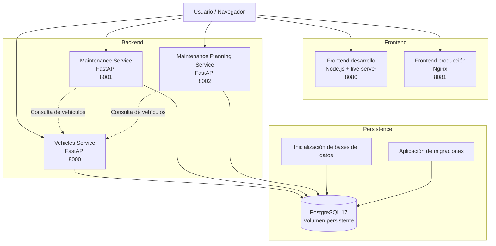

# MiGaraje — Gestión inteligente del mantenimiento de vehículos

<p align="center">
  
</p>

**Autora:** Mercedes Lorenzo Aragón  
**Asignatura:** Cloud Computing: Fundamentos e Infraestructuras  
**Titulación:** Máster Universitario en Ingeniería Informática  
**Curso académico:** 2026-2027  
**Universidad:** Universidad de Granada (UGR)

> Si quieres consultar el README entregado originalmente para el Hito 1, puedes acceder a él [aquí](docs/hito1readme.md).

---

## Índice

1. [Descripción del proyecto](#1-descripción-del-proyecto)
2. [Funcionalidades y alcance](#2-funcionalidades-y-alcance)
3. [Arquitectura Cloud Native](#3-arquitectura-cloud-native)
4. [Tecnologías utilizadas](#4-tecnologías-utilizadas)
5. [Contenerización y orquestación](#5-contenerización-y-orquestación)
6. [Configuración y ejecución local](#6-configuración-y-ejecución-local)
7. [Pruebas y validación](#7-pruebas-y-validación)
8. [Integración continua y publicación de imágenes](#8-integración-continua-y-publicación-de-imágenes)
9. [Documentación adicional](#9-documentación-adicional)
10. [Evolución del proyecto](#10-evolución-del-proyecto)
11. [Referencias](#11-referencias)

---

## 1. Descripción del proyecto

**MiGaraje** es una aplicación web cloud-native destinada a facilitar la gestión de vehículos personales y la planificación de sus mantenimientos.

El mantenimiento de un vehículo implica realizar numerosas tareas a lo largo de su vida útil: cambios de aceite y filtros, revisiones de frenos y neumáticos, sustitución de líquidos, inspecciones técnicas periódicas (ITV) y reparaciones de distinta naturaleza.

Habitualmente, esta información se encuentra dispersa entre facturas, notas, hojas de cálculo y recordatorios independientes. Esta situación dificulta consultar el historial completo de un vehículo, recordar las próximas revisiones y controlar los gastos asociados a su mantenimiento.

MiGaraje propone centralizar esta información en una aplicación que permita registrar vehículos, almacenar sus intervenciones y planificar las tareas de mantenimiento.

El proyecto se desarrolla mediante una **arquitectura basada en microservicios independientes**, utilizando APIs REST, contenedores Docker y PostgreSQL. Su diseño está orientado a aplicar los principios de Cloud Computing y facilitar su posterior despliegue en una infraestructura cloud.

### 1.1. Objetivos

Los principales objetivos del proyecto son:

- Facilitar la gestión de uno o varios vehículos personales.
- Mantener un historial de reparaciones y operaciones de mantenimiento.
- Planificar tareas periódicas según fechas y kilometraje.
- Detectar tareas próximas a vencer o que ya han superado su plazo.
- Registrar los gastos asociados a cada vehículo.
- Desarrollar una arquitectura distribuida mediante microservicios.
- Contenerizar los componentes y proporcionar un entorno local reproducible.
- Automatizar la validación del código y la construcción y publicación de imágenes Docker.

## 2. Funcionalidades y alcance

MiGaraje contempla las siguientes áreas funcionales:

| Área | Descripción |
|---|---|
| Gestión de vehículos | Registro, consulta, modificación y eliminación de vehículos. |
| Mantenimientos | Registro de reparaciones e intervenciones realizadas. |
| Planificación | Definición de reglas y generación de tareas de mantenimiento. |
| Historial | Consulta de las intervenciones asociadas a cada vehículo. |
| Gastos | Registro de los costes relacionados con los mantenimientos. |

La implementación se realiza de forma progresiva. Actualmente, el proyecto dispone de los tres microservicios backend y de una página web estática que presenta la aplicación y permite acceder a la documentación interactiva de sus APIs.

La interfaz gráfica todavía no implementa todas las operaciones de gestión funcionales. Estas operaciones se exponen a través de las APIs REST y pueden probarse mediante Swagger UI.

## 3. Arquitectura Cloud Native

MiGaraje sigue una arquitectura de microservicios en la que cada servicio mantiene una responsabilidad funcional diferenciada y puede construirse y ejecutarse de manera independiente.

### 3.1. Componentes principales

| Componente | Responsabilidad | Puerto |
|---|---|---:|
| Frontend | Página web y acceso a las APIs. | 8080 / 8081 |
| Vehicles Service | Gestión de vehículos. | 8000 |
| Maintenance Service | Gestión de intervenciones y mantenimientos. | 8001 |
| Maintenance Planning Service | Reglas y tareas de planificación. | 8002 |
| PostgreSQL | Persistencia de los datos de los microservicios. | 5432 |

Los tres microservicios backend están desarrollados con FastAPI y exponen sus operaciones mediante APIs REST.

Cada servicio mantiene su propia base de datos lógica en PostgreSQL, preservando la separación de responsabilidades y la propiedad de los datos.

### 3.2. Comunicación entre componentes

La comunicación entre los contenedores backend se realiza mediante una red interna de Docker Compose. Los servicios utilizan los nombres de los contenedores definidos en la configuración para localizarse entre sí.

El frontend se ejecuta de forma independiente y puede acceder a las APIs mediante las direcciones publicadas en el equipo anfitrión.

Los microservicios incorporan middleware CORS para permitir las peticiones desde los dos orígenes locales del frontend:

- `http://localhost:8080`
- `http://localhost:8081`

### 3.3. Persistencia

PostgreSQL se ejecuta en un contenedor independiente. Los datos se almacenan en un volumen persistente gestionado por Docker Compose, de manera que no dependen del ciclo de vida del contenedor.

La inicialización de las bases de datos y la aplicación de migraciones se realizan mediante los servicios auxiliares definidos en `compose.yaml`.

### 3.4. Diagrama de arquitectura



El diagrama representa la organización lógica de los componentes. Docker Compose coordina su ejecución y establece las dependencias necesarias para el arranque.

## 4. Tecnologías utilizadas

| Tecnología | Utilización |
|---|---|
| Python 3.12 | Lenguaje de programación de los microservicios. |
| FastAPI | Desarrollo de las APIs REST. |
| Pydantic | Validación y gestión de datos. |
| SQLAlchemy | Acceso y gestión de la persistencia. |
| PostgreSQL 17 | Sistema gestor de bases de datos. |
| Alembic | Gestión de migraciones de base de datos. |
| HTML y CSS | Desarrollo de la interfaz web. |
| Node.js 22 Alpine | Entorno de desarrollo del frontend. |
| Nginx Alpine | Servidor web del frontend de producción. |
| Docker | Construcción y ejecución de contenedores. |
| Docker Compose | Orquestación del entorno local. |
| Git y GitHub | Control de versiones y gestión del proyecto. |
| GitHub Actions | Automatización de integración continua. |
| Ruff | Análisis estático y formato del código Python. |
| pytest | Ejecución de pruebas automatizadas. |
| Hadolint | Análisis de los Dockerfiles. |
| GitHub Container Registry | Almacenamiento y distribución de imágenes Docker. |

## 5. Contenerización y orquestación

Los componentes de MiGaraje se empaquetan en imágenes Docker independientes.

Los tres microservicios backend utilizan Dockerfiles con construcción multi-stage, separación entre dependencias y código fuente y ejecución mediante un usuario sin privilegios.

El frontend dispone de dos objetivos de construcción:

- **Development:** utiliza Node.js y `live-server`, con montaje del código local para facilitar el desarrollo.
- **Production:** utiliza Nginx para servir los archivos estáticos sin incorporar herramientas de desarrollo.

Docker Compose coordina los contenedores, sus variables de entorno, las redes internas, los puertos publicados, las comprobaciones de salud y los volúmenes persistentes.

Para conocer los detalles de las imágenes, sus etapas de construcción y la configuración de Compose, consulta [`docs/docker.md`](docs/docker.md).

## 6. Configuración y ejecución local

### 6.1. Requisitos previos

Para ejecutar el entorno local se necesita:

- Docker Desktop con Docker Compose.
- Git para clonar el repositorio.
- Un sistema operativo compatible con Docker.

No es necesario instalar PostgreSQL ni Python en el equipo anfitrión para ejecutar el entorno completo mediante contenedores.

### 6.2. Clonar el repositorio

```bash
git clone https://github.com/MercheLorenzo/MiGaraje.git
cd MiGaraje
```

### 6.3. Configurar las variables de entorno

El proyecto utiliza un archivo `.env` para configurar PostgreSQL y las conexiones de los microservicios.

Crear el archivo local a partir de la plantilla:

```powershell
Copy-Item .env.example .env
```

Editar `.env` y configurar los valores correspondientes al entorno local.

**Importante:** no se debe sobrescribir un archivo `.env` existente sin conservar previamente su configuración. El archivo contiene credenciales locales y no debe subirse al repositorio.

### 6.4. Construir e iniciar el entorno

Desde la raíz del proyecto:

```bash
docker compose config --quiet
docker compose up -d --build
```

El primer comando valida la configuración de Compose. El segundo construye las imágenes necesarias y arranca los servicios definidos.

### 6.5. Acceso a los componentes

Una vez iniciados los contenedores, los servicios están disponibles en las siguientes direcciones:

| Componente | Dirección |
|---|---|
| Frontend de desarrollo | http://localhost:8080 |
| Frontend de producción | http://localhost:8081 |
| Vehicles Service - Swagger | http://localhost:8000/docs |
| Maintenance Service - Swagger | http://localhost:8001/docs |
| Maintenance Planning Service - Swagger | http://localhost:8002/docs |

### 6.6. Inspección y gestión del entorno

Consultar el estado de los contenedores:

```bash
docker compose ps
```

Consultar los registros:

```bash
docker compose logs -f
```

Consultar los registros de un servicio concreto:

```bash
docker compose logs -f vehicles-service
```

Detener el entorno:

```bash
docker compose down
```

Este último comando detiene y elimina los contenedores y la red creada por Compose, pero conserva los datos almacenados en los volúmenes persistentes.

**No utilizar `docker compose down -v` si se desea conservar la información de PostgreSQL.**

## 7. Pruebas y validación

MiGaraje incorpora pruebas automatizadas para comprobar el comportamiento de los tres microservicios backend.

Las pruebas unitarias y de API utilizan `pytest`, `FastAPI TestClient` y bases de datos SQLite independientes, evitando modificar los datos almacenados en PostgreSQL.

Para ejecutar las pruebas de un microservicio, instalar sus dependencias de desarrollo y ejecutar:

```bash
python -m pytest -v
```

El proyecto también dispone de un script de pruebas de integración que realiza peticiones HTTP reales a los tres microservicios desplegados mediante Docker Compose.

Estas pruebas verifican la disponibilidad de los servicios, la creación de recursos y la validación de las relaciones entre vehículos, mantenimientos, reglas y tareas.

La documentación detallada de las pruebas está disponible en [`docs/testing.md`](docs/testing.md).

### 7.1. Comprobaciones de salud

Los tres microservicios exponen endpoints de salud:

| Endpoint | Finalidad |
|---|---|
| `/health` | Comprobación básica de disponibilidad. |
| `/health/live` | Comprobación de que el proceso está activo. |
| `/health/ready` | Comprobación de disponibilidad y conexión con la base de datos. |

Docker Compose incorpora health checks para PostgreSQL, los microservicios y ambos frontends.

Los detalles y comandos de verificación se encuentran en [`docs/health-checks.md`](docs/health-checks.md).

## 8. Integración continua y publicación de imágenes

El proyecto utiliza **GitHub Actions** para automatizar la validación del código y la construcción y publicación de imágenes Docker.

El workflow está definido en:

```text
.github/workflows/ci.yml
```

Se ejecuta ante los siguientes eventos:

- `push` a la rama `main`.
- `pull_request` dirigido a `main`.
- Ejecución manual mediante `workflow_dispatch`.

El pipeline se organiza en cinco jobs:

| Job | Función |
|---|---|
| `test` | Ejecuta Ruff y pytest en los tres microservicios. |
| `lint-dockerfiles` | Analiza los cuatro Dockerfiles mediante Hadolint. |
| `build-images` | Construye las cuatro imágenes utilizando el target `production`. |
| `integration-tests` | Levanta el entorno backend con Docker Compose y ejecuta las pruebas de integración. |
| `publish-images` | Publica las imágenes de producción en GHCR cuando las validaciones anteriores han finalizado correctamente. |

### 8.1. Publicación en GitHub Container Registry

Las imágenes se publican en **GitHub Container Registry (GHCR)** utilizando el token automático `GITHUB_TOKEN` de GitHub Actions.

Cada imagen se etiqueta con el identificador completo del commit que la ha generado, siguiendo el formato:

```text
sha-<identificador-del-commit>
```

Las imágenes publicadas son:

| Componente | Imagen |
|---|---|
| Vehicles Service | `ghcr.io/merchelorenzo/migaraje-vehicles-service` |
| Maintenance Service | `ghcr.io/merchelorenzo/migaraje-maintenance-service` |
| Maintenance Planning Service | `ghcr.io/merchelorenzo/migaraje-maintenance-planning-service` |
| Frontend | `ghcr.io/merchelorenzo/migaraje-frontend` |

Ejemplo de descarga de una imagen:

```bash
docker pull ghcr.io/merchelorenzo/migaraje-vehicles-service:sha-eb36fe05e5f5d1fae6f92f3dd556b8c6629afd80
```

La publicación está limitada a los cambios enviados a `main` y a las ejecuciones manuales realizadas desde esa rama. Los Pull Requests ejecutan las validaciones, pero no publican imágenes.

### 8.2. Consulta de resultados

Las ejecuciones del pipeline pueden consultarse en:

[GitHub Actions — MiGaraje](https://github.com/MercheLorenzo/MiGaraje/actions)

Los paquetes publicados están disponibles en:

[GitHub Packages — MiGaraje](https://github.com/MercheLorenzo?tab=packages)

Para obtener más información sobre los jobs, sus herramientas y las validaciones realizadas, consulta [`docs/ci.md`](docs/ci.md).

## 9. Documentación adicional

El repositorio contiene documentación técnica complementaria:

| Documento | Contenido |
|---|---|
| [`docs/docker.md`](docs/docker.md) | Dockerfiles, construcción multi-stage, optimización de imágenes y Docker Compose. |
| [`docs/frontend.md`](docs/frontend.md) | Frontend de desarrollo y producción, acceso a las APIs y configuración CORS. |
| [`docs/health-checks.md`](docs/health-checks.md) | Endpoints de salud y comprobaciones de Docker. |
| [`docs/testing.md`](docs/testing.md) | Pruebas unitarias, aislamiento y pruebas de integración. |
| [`docs/ci.md`](docs/ci.md) | GitHub Actions, validaciones y publicación de imágenes en GHCR. |

## 10. Evolución del proyecto

El desarrollo de MiGaraje se organiza en hitos progresivos dentro de la asignatura Cloud Computing.

- **Hito 1 — Definición del proyecto, modelo de negocio y arquitectura de referencia:** definición del problema, funcionalidades, propuesta de valor y diseño inicial de la arquitectura.
- **Hito 2 — Empaquetado Cloud Native, entorno local e integración continua:** contenerización de los componentes, orquestación mediante Docker Compose, pruebas automatizadas y publicación de imágenes en GHCR.
- **Hito 3 — Infraestructura como código y patrón reconciliador:** incorporación de mecanismos para definir y gestionar la infraestructura de forma automatizada.
- **Hito 4 — Despliegue continuo y reconciliación automatizada:** evolución del proceso de despliegue y automatización de la convergencia del sistema hacia el estado deseado.

La implementación de las funcionalidades y de la infraestructura continuará evolucionando conforme a los objetivos de cada hito.

## 11. Referencias

- Mell, P. y Grance, T. (2011). *The NIST Definition of Cloud Computing*. NIST Special Publication 800-145. National Institute of Standards and Technology. https://doi.org/10.6028/NIST.SP.800-145
- Liu, F., Tong, J., Mao, J., Bohn, R., Messina, J., Badger, L. y Leaf, D. (2011). *NIST Cloud Computing Reference Architecture*. NIST Special Publication 500-292. National Institute of Standards and Technology. https://doi.org/10.6028/NIST.SP.500-292
- Villalonga, C. (s. f.). *CC-26-27* [Repositorio docente de GitHub]. GitHub. https://github.com/cvillalonga/CC-26-27/tree/main
