# MiGaraje — Hito 3: Infraestructura como Código en AWS

**Asignatura:** Cloud Computing · Universidad de Granada  
**Proyecto:** MiGaraje — Gestión de vehículos y mantenimientos  
**Fecha de realización de las pruebas:** 25 de noviembre de 2026  
**Rama de desarrollo:** `feature/hito3-terraform`  
**Alcance de esta memoria:** issues **#22, #23, #24, #25, #26 y #27**, desde la preparación de Terraform hasta la destrucción controlada y la verificación de limpieza.

> **Estado de la entrega:** Hito 3 ejecutado y documentado. Se desplegó y verificó MiGaraje, se demostró el bloqueo remoto de S3, se detectó y corrigió el *drift* y se destruyeron los **20 recursos gestionados por Terraform**. El estado final quedó vacío y se comprobó la limpieza del laboratorio. **Se conserva expresamente el bucket S3 del backend para los hitos 4 y 5.** Las capturas son de ejecuciones reales.

## 1. Objetivo, alcance y resultado

El Hito 3 consiste en describir y aprovisionar con Terraform una infraestructura reproducible para desplegar MiGaraje en la nube. La solución comprende la red y sus reglas de seguridad, el cómputo, el almacenamiento persistente, el estado remoto de Terraform y una prueba de reconciliación de cambios realizados fuera del código y, finalmente, la retirada controlada de los recursos para verificar la reversibilidad del aprovisionamiento.

Se ha utilizado **Amazon Web Services (AWS)** en **Estocolmo, Suecia (`eu-north-1`)**, región de la Unión Europea permitida por el proyecto gratuito de AWS. En la fecha de las pruebas se disponía de un **AWS Free Plan con 100 USD de créditos promocionales**. El uso de EC2, EBS, S3 e IPv4 pública puede consumir estos créditos: **elegibilidad Free Tier no equivale a coste cero**.

| Aspecto | Resultado real |
|---|---|
| Inicialización y validación | Terraform `v1.17.2`; proveedor AWS `v5.100.0`; `terraform validate` correcto |
| Plan inicial | `20 to add, 0 to change, 0 to destroy` |
| Aprovisionamiento | `Apply complete! Resources: 20 added, 0 changed, 0 destroyed` |
| Servidor | EC2 `m7i-flex.large`, Ubuntu, `eu-north-1a`, estado `running` |
| Aplicación | Frontend Nginx y seis microservicios; contenedores `healthy` |
| Persistencia | PostgreSQL 17 y Docker sobre volumen EBS gp3 cifrado |
| Pruebas HTTP | Frontend `200 OK`; gateway `/health/ready` devuelve `{"status":"ok","database":"ok"}` |
| Estado remoto | S3 privado con SSE-S3, versionado y `use_lockfile = true` |
| Bloqueo | Segundo proceso rechazado con `Error acquiring the state lock` y error S3 HTTP 412 |
| Reconciliación | Etiqueta modificada manualmente; `apply` revierte un cambio y `plan` final indica `No changes` |
| Teardown (Issue #27) | `Plan: 0 to add, 0 to change, 20 to destroy` y `Destroy complete! Resources: 20 destroyed` |
| Verificación de limpieza | Estado Terraform vacío; plan de destrucción sin objetos; EC2 `terminated`; sin volúmenes EBS, VPC ni SG del laboratorio en las consultas realizadas |
| Backend después de destruir | Bucket S3 privado conservado deliberadamente para reutilizar el estado remoto en los hitos 4 y 5 |

**Figura 1.** Terraform valida la configuración HCL y el esquema de los proveedores.

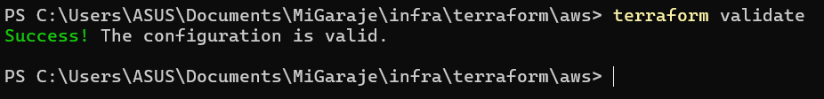

## 2. Arquitectura desplegada

La infraestructura se define en `infra/terraform/aws/` mediante módulos independientes de red, cómputo y almacenamiento. Un proceso de *cloud-init* instala Docker, clona la rama publicada de MiGaraje y levanta los servicios mediante Docker Compose. La base de datos está en la **misma instancia EC2**: la subred privada existe para cumplir la separación lógica de red, pero **no hospeda PostgreSQL en este hito**.

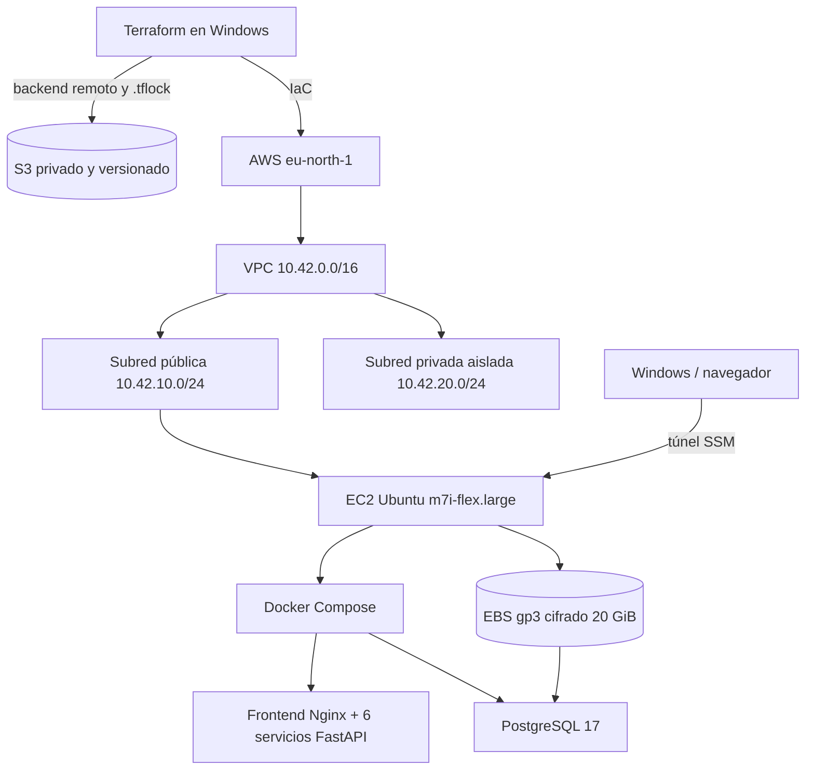

**Decisiones de diseño:** una sola VM y zona de disponibilidad para limitar complejidad; una subred pública con Internet Gateway y una privada sin NAT; Security Group sin reglas entrantes; acceso administrativo por Systems Manager; almacenamiento cifrado separado; sin RDS, NAT Gateway ni balanceador. Es una **arquitectura de laboratorio, no de alta disponibilidad**.

## 3. Issue #22 — Estructura Terraform y validación

### 3.1. Organización del código

```text
infra/terraform/aws/
├── providers.tf               # versión de Terraform, provider AWS, backend S3
├── variables.tf               # parámetros y validaciones
├── main.tf                    # módulos y asociación del disco
├── outputs.tf                 # IDs de VPC, EC2, EBS, SG y túnel SSM
├── modules/
│   ├── network/               # VPC, subredes, tablas, IGW y Security Group
│   ├── compute/               # EC2, Ubuntu e IAM/SSM
│   └── storage/               # volumen EBS gp3 cifrado
├── templates/cloud-init.sh.tftpl
├── scripts/bootstrap-state.ps1
├── scripts/preflight-free-plan.ps1
├── terraform.tfvars.example   # ejemplo no secreto
└── backend.hcl.example        # ejemplo de backend no secreto
```

Las configuraciones locales `terraform.tfvars` y `backend.hcl`, los estados `*.tfstate`, los planes `*.tfplan` y la carpeta `.terraform/` quedan fuera de Git. Por el contrario, `.terraform.lock.hcl` se versiona para fijar el proveedor elegido.

La rama `feature/hito3-terraform` se publicó en GitHub antes de desplegar para que *cloud-init* pudiera obtener el código mediante `repository_ref`. Se ejecutaron `terraform init -backend-config .\backend.hcl`, `terraform fmt -recursive`, `terraform validate` y `terraform plan`.

### 3.2. Integración continua

Se añadió `.github/workflows/terraform.yml`, que define un trabajo de validación con `terraform fmt -check -recursive`, `terraform init -backend=false`, `terraform validate` y `scripts/test_hito3_structure.py`, sin desplegar infraestructura ni usar claves AWS en el workflow. **Se acredita la presencia y finalidad del workflow en el repositorio, no una ejecución verde de GitHub Actions, cuya captura no se ha aportado.**

**Evidencias:** `terraform_validate.png` y `evidencia_20added.png` (resultado posterior del aprovisionamiento).

## 4. Issue #23 — Red y seguridad

La red desplegada tiene **VPC `10.42.0.0/16`**, subred **pública `10.42.10.0/24`** y subred **privada `10.42.20.0/24`**, ambas en `eu-north-1a`. La subred pública está asociada a una tabla con ruta `0.0.0.0/0` hacia el Internet Gateway; la privada **solo tiene ruta local** `10.42.0.0/16`, por lo que no se le ha configurado salida directa a Internet.

**Figura 2.** Mapa de recursos de la VPC: subredes, tablas de rutas e Internet Gateway.

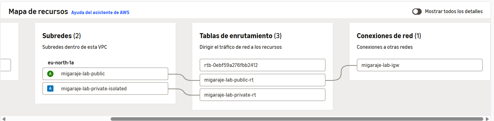

**Figura 3.** Tabla de rutas pública: ruta local y salida hacia el Internet Gateway.

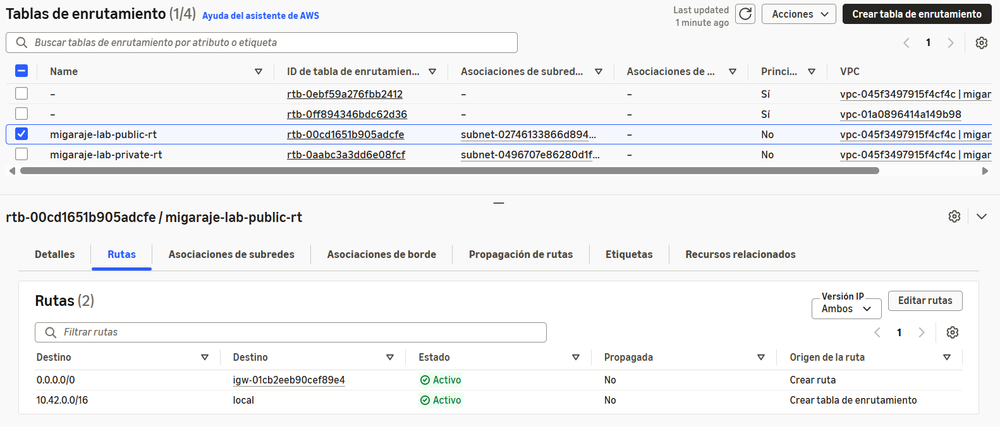

**Figura 4.** Tabla de rutas privada: únicamente ruta local, sin NAT Gateway.

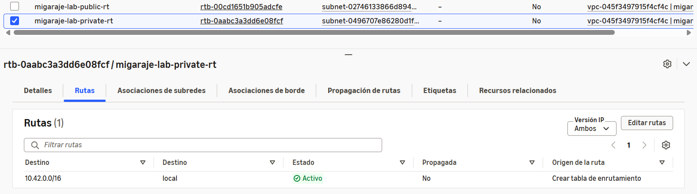

El Security Group **`migaraje-lab-sg`** se creó con **cero reglas de entrada**. El acceso remoto se hace por AWS Systems Manager, de modo que no es necesario abrir SSH (`22/tcp`), PostgreSQL (`5432/tcp`) ni el puerto web a Internet. Las cuatro reglas de salida permiten DNS TCP/UDP `53` dentro de la VPC, además de HTTP `80` y HTTPS `443` hacia Internet para instalación y comunicación con servicios externos.

**Figura 5.** Security Group sin reglas entrantes.

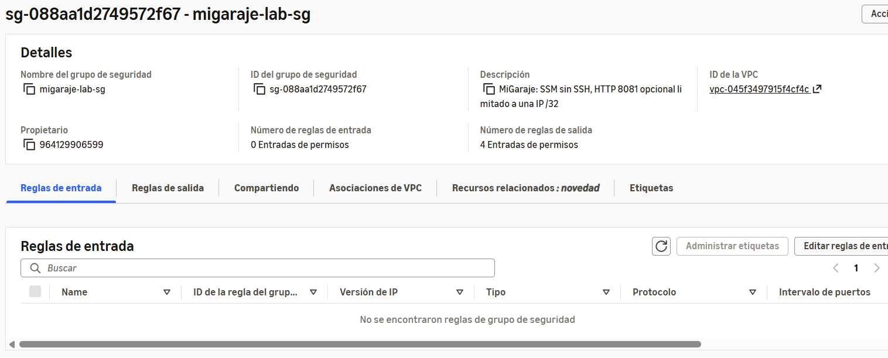

**Figura 6.** Reglas de salida del Security Group.

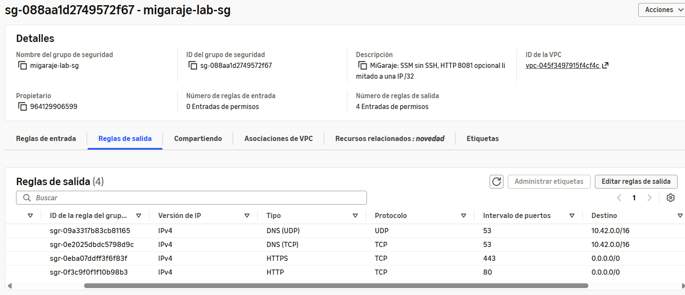

**Resultado #23:** red y seguridad desplegadas de acuerdo con el modelo de mínimo acceso entrante. La subred privada se mantiene vacía en este hito; no se debe presentar como base de datos gestionada ni como arquitectura de alta disponibilidad.

## 5. Issue #24 — Cómputo, aplicación y persistencia

### 5.1. Aprovisionamiento de EC2

Terraform creó **20 recursos** en el primer `apply` y devolvió los identificadores de EC2, VPC, subredes, Security Group y volumen EBS. La VM es una **EC2 `m7i-flex.large` con Ubuntu 24.04 (x86_64)**, ejecutada en `eu-north-1a`. Se asoció un rol IAM con la política administrada `AmazonSSMManagedInstanceCore` para conexión por SSM.

**Figura 7.** Resultado real de Terraform: 20 recursos creados.

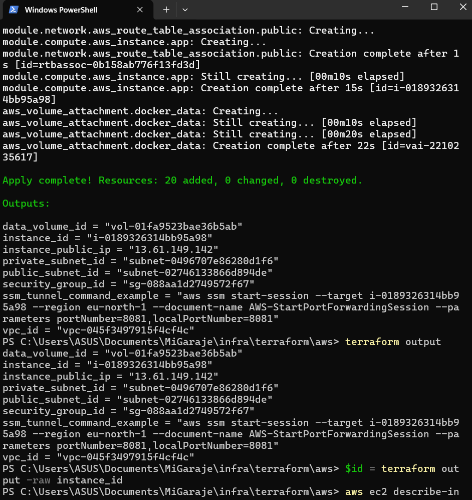

**Figura 8.** Instancia EC2 en ejecución y comprobaciones de estado correctas.

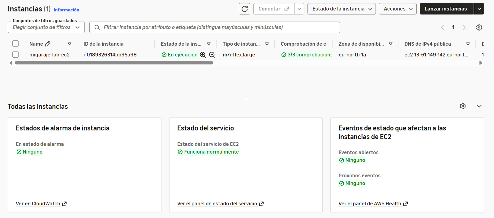

### 5.2. Despliegue automático con Docker Compose

El arranque automatizado instaló Docker, clonó el repositorio y ejecutó las migraciones antes de iniciar PostgreSQL 17, Nginx y los seis servicios FastAPI: vehículos, mantenimiento, planificación, estadísticas, notificaciones y gateway. En la comprobación de `sudo docker compose ps -a`, los servicios persistentes constan como **`Up (healthy)`** y las tareas de inicialización/migración como **`Exited (0)`**, que es el resultado esperado para trabajos de ejecución única.

**Figura 9.** Contenedores de MiGaraje y resultado de las migraciones.

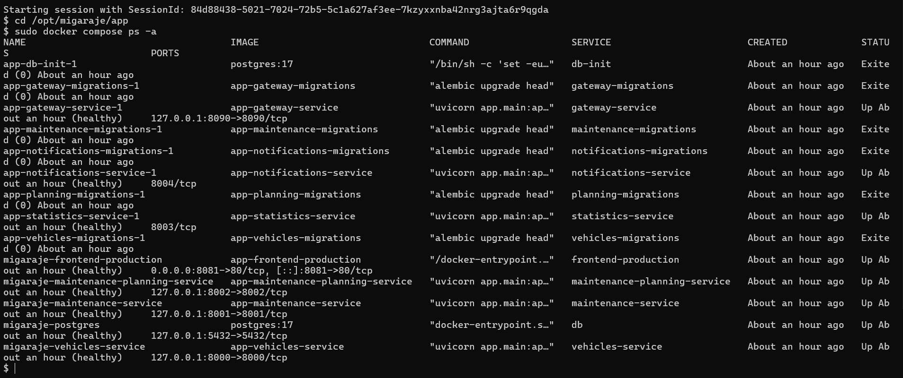

Se verificaron los endpoints locales desde EC2:

```bash
curl -I http://127.0.0.1:8081/
# HTTP/1.1 200 OK

curl -i http://127.0.0.1:8090/health/ready
# HTTP/1.1 200 OK
# {"status":"ok","database":"ok"}
```

**Figura 10.** Respuestas HTTP 200 del frontend y del gateway.

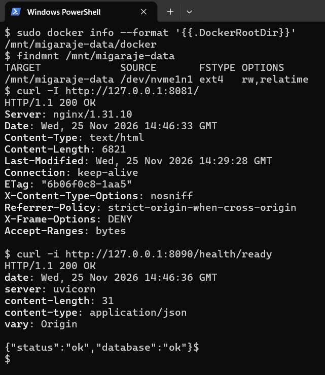

Para acceder al navegador Windows se utilizó **SSM Port Forwarding** con puerto local `18081` hacia el puerto remoto `8081`, sin abrir reglas entrantes. Se comprobó que aparece la pantalla de inicio de sesión. **La captura acredita acceso al frontend; no constituye por sí sola una prueba de extremo a extremo de registro, vehículos y mantenimientos.**

**Figura 11.** Interfaz de MiGaraje a través del túnel SSM.

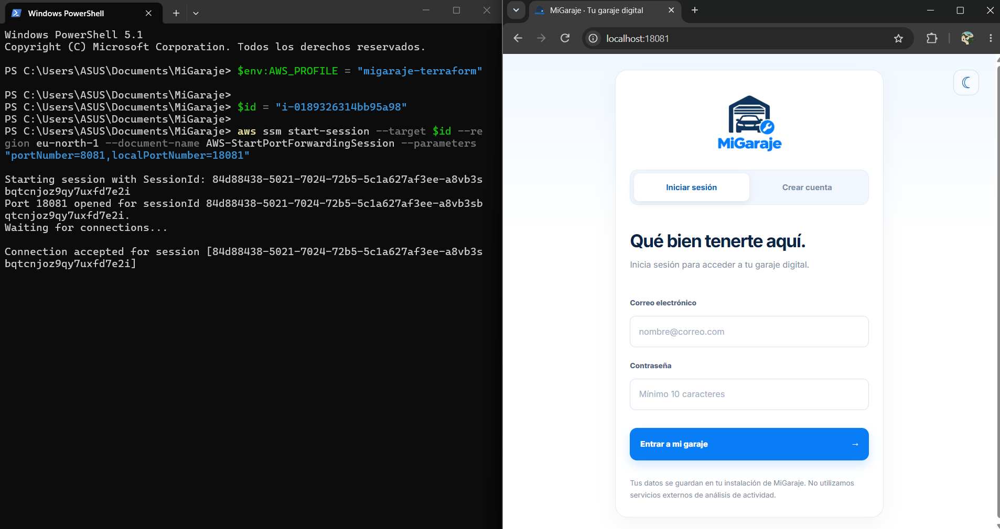

### 5.3. Almacenamiento EBS cifrado

La infraestructura utiliza **20 GiB gp3 para el volumen raíz** y **20 GiB gp3 para datos Docker/PostgreSQL**. El volumen de datos figura en AWS como **«En uso»**, asociado a la instancia y cifrado con la clave administrada de EBS (`aws/ebs`). En Ubuntu se comprobó:

```bash
sudo docker info --format '{{.DockerRootDir}}'
# /mnt/migaraje-data/docker

findmnt /mnt/migaraje-data
# /dev/nvme1n1  ext4  rw,relatime
```

**Figura 12.** Volumen de datos gp3, 20 GiB y asociación con EC2.

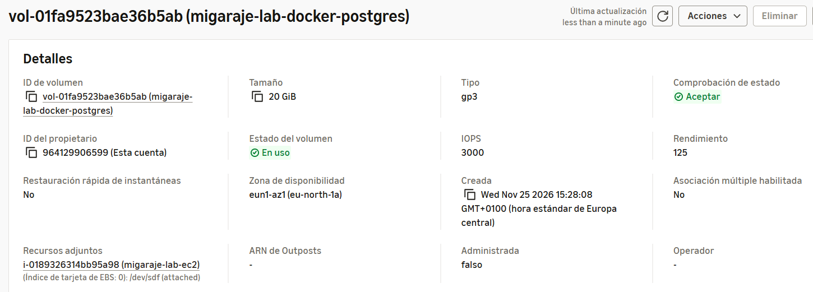

**Figura 13.** Cifrado del volumen mediante clave administrada `aws/ebs`.

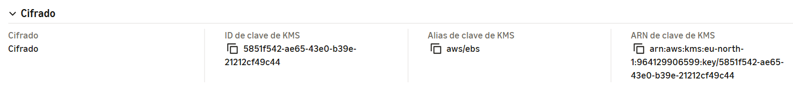

**Resultado #24:** infraestructura EC2 y persistencia operativas; el frontend, gateway y contenedores están saludables, con Docker sobre EBS. **Limitación:** la persistencia estaba ligada al volumen EBS, eliminado posteriormente con `terraform destroy` durante la Issue #27; no se implementó alta disponibilidad ni base de datos administrada.

## 6. Issue #25 — Estado remoto S3 y bloqueo concurrente

### 6.1. Backend remoto y protección de la información

El backend de Terraform se almacena en un **bucket S3 privado en `eu-north-1`** preparado con `scripts/bootstrap-state.ps1` antes del `apply`. El bucket está fuera del propio estado Terraform de la aplicación para que `destroy` no elimine el backend mientras está en uso.

Configuración de ejemplo (nombre de bucket sustituido por marcador para no fijar el identificador de cuenta en este documento):

```hcl
bucket       = "migaraje-hito3-state-<ID_CUENTA>-eu-north-1"
key          = "migaraje/hito3/terraform.tfstate"
region       = "eu-north-1"
encrypt      = true
use_lockfile = true
```

Medidas verificadas en S3:

- **Versionado habilitado** para conservar versiones del estado.
- **Bloqueo de todo acceso público activado**, con sus cuatro controles individuales.
- **Cifrado por defecto SSE-S3 (`AES256`)** para objetos del bucket.
- **Bloqueo nativo del estado con S3** mediante fichero `.tflock`, sin tabla DynamoDB.

**Figura 14.** Versionado del bucket habilitado.

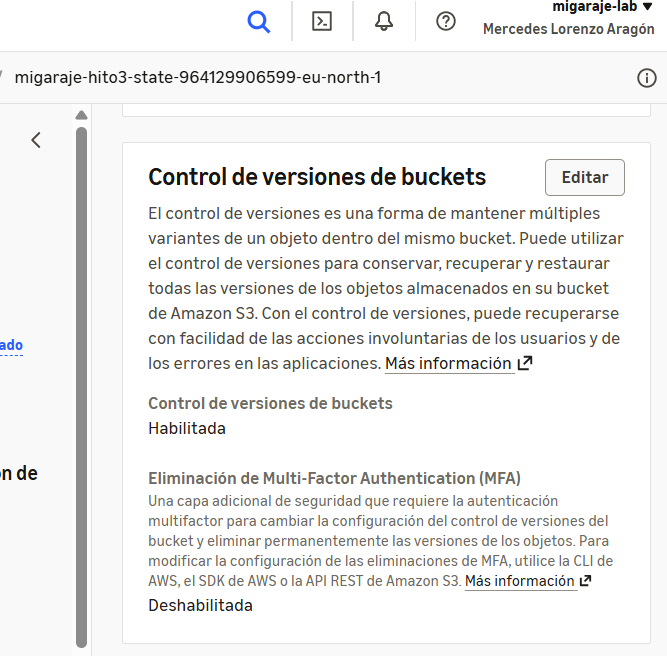

**Figura 15.** Bloqueo de acceso público de S3 activado.

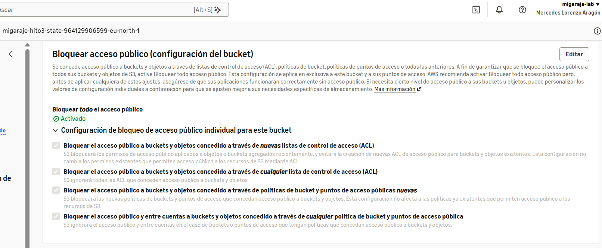

**Figura 16.** Cifrado predeterminado SSE-S3.

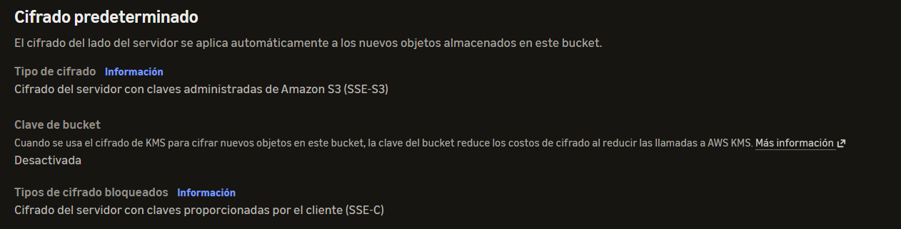

### 6.2. Experimento de bloqueo concurrente

Con la modificación de la etiqueta `DriftDemo` aún pendiente de corregir, se abrieron **dos terminales PowerShell** autenticadas y con el mismo directorio/backend:

1. **Terminal A:** `terraform apply -var-file ".\terraform.tfvars"`, mantenido en la solicitud de confirmación (`Enter a value:`), conservando el bloqueo.
2. **Terminal B:** `terraform plan -var-file ".\terraform.tfvars" -lock-timeout=5s`.
3. La segunda terminal devolvió **`Error acquiring the state lock`** y **S3 `PutObject` HTTP `412 PreconditionFailed`**, junto con la operación propietaria `OperationTypeApply`.
4. Se canceló de forma normal la primera operación y se liberó el bloqueo, sin usar `-lock=false` ni `force-unlock`.

**Figura 17.** Dos sesiones concurrentes: la segunda no puede adquirir el bloqueo.

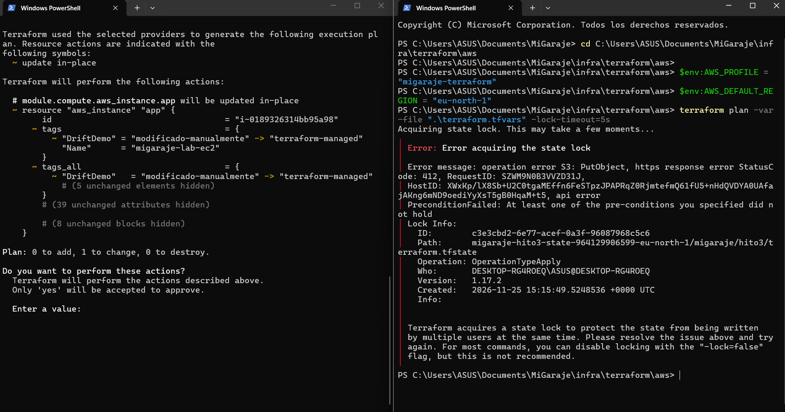

**Resultado #25:** el estado remoto S3 queda protegido frente a operaciones Terraform concurrentes, y la configuración de privacidad, cifrado y versionado está demostrada. Esta prueba valida el bloqueo funcional; no implica que se haya auditado una política IAM de mínimo privilegio de producción.

## 7. Issue #26 — Detección y reconciliación de drift

El experimento modifica **solo una etiqueta de EC2**, para no alterar conectividad, capacidad ni seguridad de la aplicación.

| Fase | Acción | Resultado |
|---|---|---|
| 1. Estado inicial | `terraform plan -var-file .\terraform.tfvars` | `No changes` |
| 2. Cambio externo | En AWS EC2, `DriftDemo`: `terraform-managed` → `modificado-manualmente` | Diferencia deliberada respecto al código |
| 3. Detección | Nuevo `terraform plan` | `0 to add, 1 to change, 0 to destroy` |
| 4. Reconciliación | `terraform apply` | `0 added, 1 changed, 0 destroyed` |
| 5. Verificación | Etiqueta AWS y último `terraform plan` | `terraform-managed`; `No changes` |

**Figura 18.** Cambio manual introducido en la consola EC2.

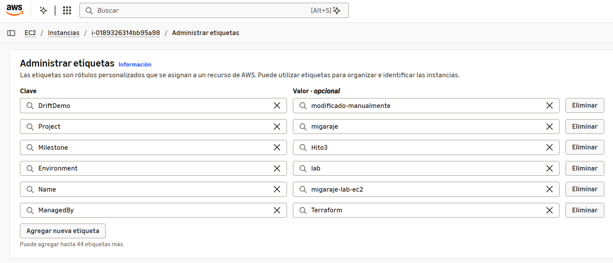

**Figura 19.** Terraform propone revertir la modificación manual de la etiqueta.

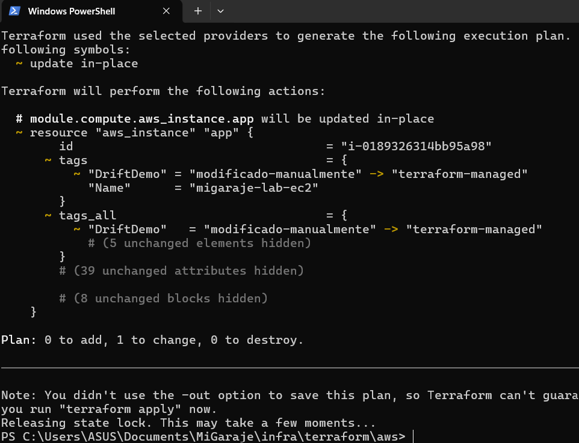

**Figura 20.** Terraform aplica una actualización *in-place* de la etiqueta.

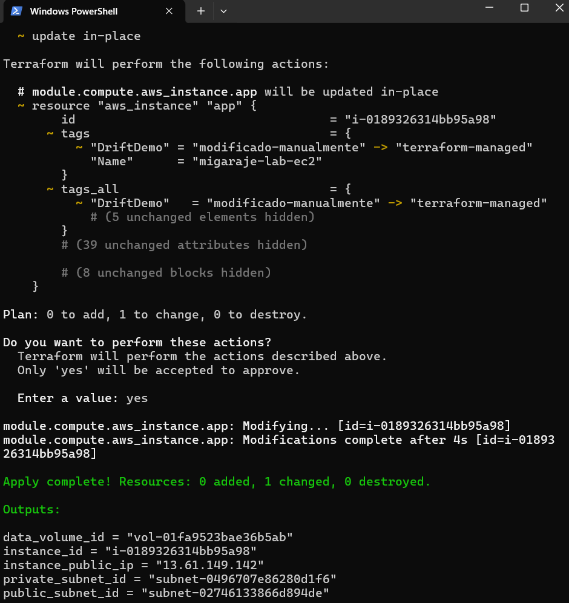

**Figura 21.** AWS muestra el valor restaurado `terraform-managed`.

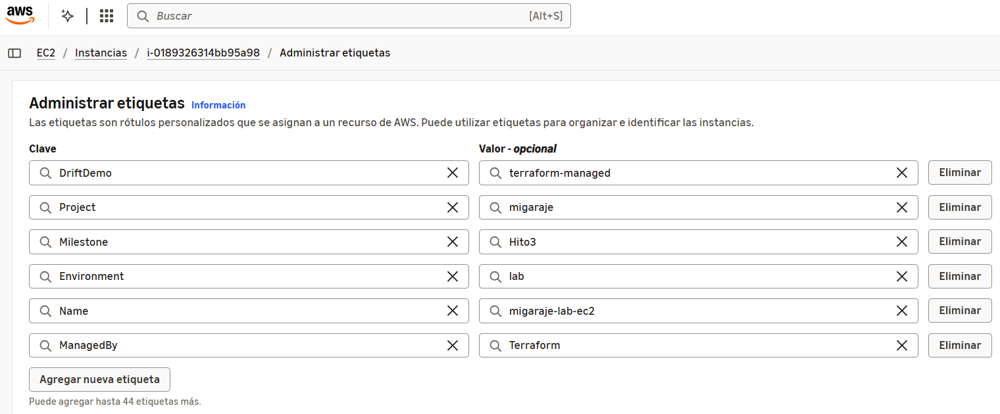

**Figura 22.** Comprobación final: no existen diferencias con el estado deseado.

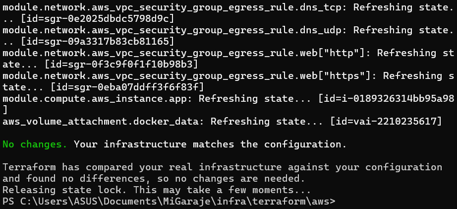

**Interpretación:** Terraform **no es un reconciliador continuo por sí solo**; al ejecutar `plan` detecta divergencias entre configuración y recursos reales, y mediante `apply` restablece el estado deseado. Se ha demostrado el patrón de reconciliación de forma controlada, sin sustituir ni recrear la instancia.

## 8. Issue #27 — Teardown controlado, verificación y cierre

### 8.1. Objetivo y precauciones

El objetivo de la Issue #27 es demostrar que una infraestructura creada mediante IaC puede retirarse de forma reproducible, comprobar que **no quedan recursos gestionados por Terraform** y distinguir los componentes que deben eliminarse de los que se conservarán intencionadamente. Esta operación se realizó después de recoger las evidencias del despliegue y de los experimentos de las issues #22–#26. Los datos de PostgreSQL en el disco EBS formaban parte del entorno de pruebas y **no se conservaron al destruir el volumen**.

La destrucción afecta al servidor EC2, los discos EBS, la red VPC, las subredes, el Internet Gateway, el Security Group y los componentes IAM creados para SSM. El **bucket S3 del estado remoto no está gestionado por este Terraform**, por lo que se decidió **conservarlo privado, cifrado y versionado para los hitos 4 y 5**. No se ejecutó un borrado manual del bucket.

### 8.2. Parada de contenedores y comprobación del desmontaje

Se accedió a Ubuntu mediante AWS Systems Manager y se ejecutó la parada ordenada de los servicios:

```bash
cd /opt/migaraje/app
sudo docker compose down
sudo docker compose ps -a
sudo systemctl stop docker.service docker.socket
cd /
sudo umount /mnt/migaraje-data
findmnt /mnt/migaraje-data
```

La captura muestra **`[+] down 15/15`**, con contenedores y red Compose retirados, seguida de una tabla vacía al ejecutar `docker compose ps -a`. La comprobación final `findmnt /mnt/migaraje-data` **no devolvió ningún montaje**. En el registro se observa también un segundo intento de `umount` que devolvió `not mounted`; por ello se documenta el **estado final desmontado comprobado**, sin atribuir a ese segundo intento el desmontaje.

**Figura 23.** Parada de los contenedores Docker y verificación del punto de montaje EBS.

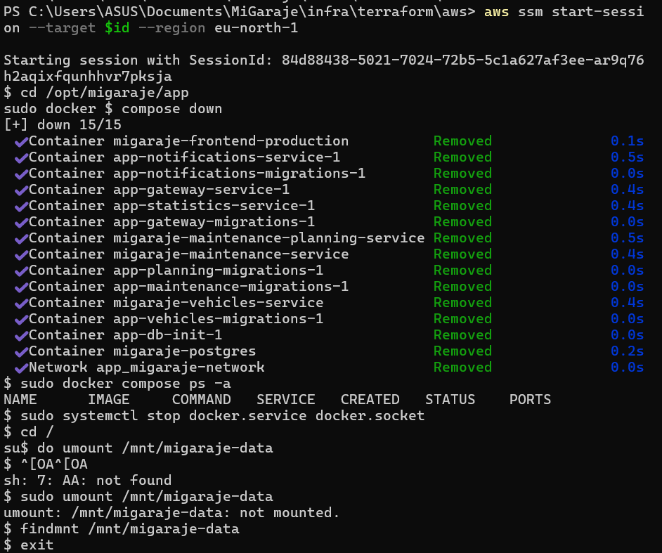

### 8.3. Plan y ejecución de la destrucción

Desde PowerShell, en `infra/terraform/aws/`, con el perfil AWS temporal `migaraje-terraform` y la región `eu-north-1`, se preparó un plan de destrucción:

```powershell
terraform plan -destroy -var-file ".\terraform.tfvars"
```

Terraform identificó **20 recursos a destruir**, sin adiciones ni modificaciones: `Plan: 0 to add, 0 to change, 20 to destroy`. El plan correspondía a los recursos de este laboratorio y no incluía el bucket S3 del backend.

**Figura 24.** Plan de destrucción: 20 recursos y ninguna creación o modificación.

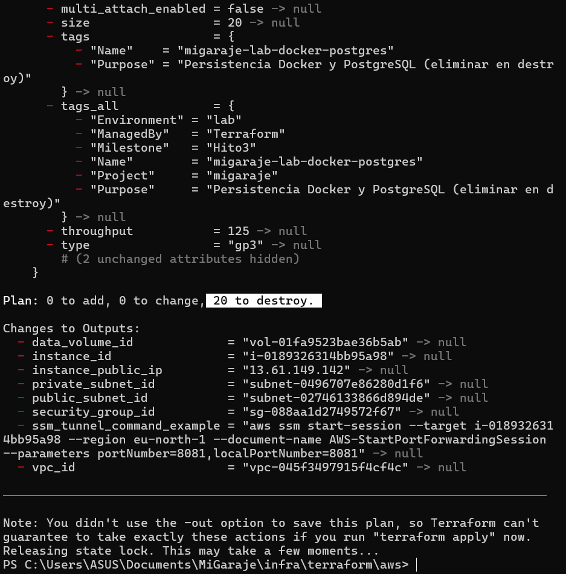

Se ejecutó posteriormente:

```powershell
terraform destroy -var-file ".\terraform.tfvars"
```

Tras confirmar la operación, Terraform terminó con el resultado **`Destroy complete! Resources: 20 destroyed.`**. Entre los recursos eliminados figura el volumen de datos EBS `migaraje-lab-docker-postgres`, por lo que los datos de PostgreSQL del laboratorio ya no se encuentran en ese disco.

**Figura 25.** Resultado de `terraform destroy`: 20 recursos destruidos.

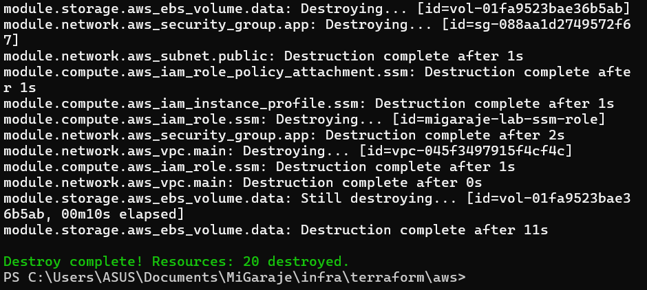

### 8.4. Verificación del estado remoto y de AWS

En primer lugar, se verificó el estado gestionado:

```powershell
terraform state list
terraform plan -destroy -var-file ".\terraform.tfvars"
```

`terraform state list` **no devolvió recursos** y el segundo comando mostró **`No changes. No objects need to be destroyed.`**. Esto acredita que el estado actual de la infraestructura administrada por Terraform ha quedado vacío; el archivo de estado y sus versiones pueden permanecer en el backend S3.

**Figura 26.** Estado vacío y nuevo plan de destrucción sin recursos pendientes.

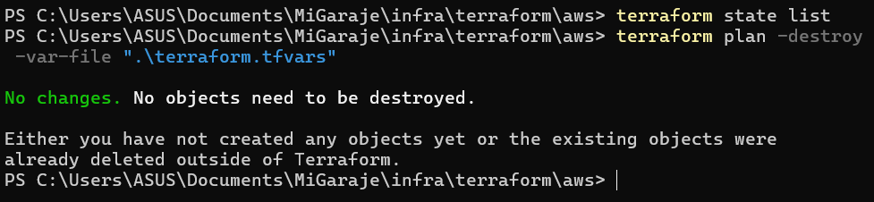

Se realizaron además comprobaciones de solo lectura contra AWS en `eu-north-1` mediante `describe-instances`, `describe-volumes`, `describe-vpcs` y `describe-security-groups`, utilizando los filtros del laboratorio:

| Recurso comprobado | Resultado observado después de destruir |
|---|---|
| EC2 de MiGaraje | Aparece como **`terminated`** en el historial; no está en ejecución |
| Volúmenes EBS con etiqueta `Project=migaraje` | Consulta sin resultados |
| VPC con nombre `migaraje-lab-vpc` | Consulta sin resultados |
| Security Group con nombre `migaraje-lab-sg` | Consulta sin resultados |

**Figura 27.** Consultas AWS tras el teardown: EC2 terminada y sin volúmenes, VPC o SG del laboratorio en las búsquedas realizadas.

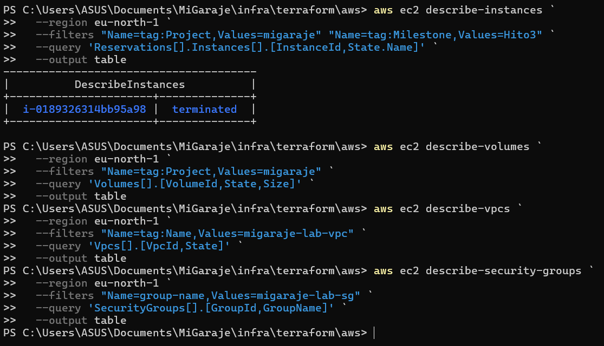

Estas comprobaciones acreditan la ausencia de los recursos buscados mediante dichos filtros. No equivalen a una auditoría general de todos los posibles recursos de la cuenta (por ejemplo, snapshots manuales ajenos al estado Terraform).

### 8.5. Recursos conservados, costes y posibilidad de redespliegue

**Decisión de conservación:** el bucket S3 privado del backend `migaraje-hito3-state-…-eu-north-1` queda **fuera del ciclo de vida del `terraform destroy` de la aplicación** y se mantiene deliberadamente para los hitos 4 y 5. Conserva versionado, cifrado SSE-S3 y bloqueo de acceso público, según las verificaciones anteriores. Su presencia no contradice el éxito del teardown de los **20 recursos gestionados por Terraform**.

El bucket, sus versiones del archivo `terraform.tfstate` y otras versiones almacenadas **pueden seguir consumiendo créditos**. Se recomienda supervisar AWS Billing y el almacenamiento del bucket. Al finalizar los siguientes hitos, su eliminación requerirá una operación separada y el tratamiento de todas las versiones de objetos. **No se afirma que la cuenta completa haya quedado sin costes ni que el bucket se haya eliminado.**

**Resultado #27:** se acredita la parada ordenada de MiGaraje, la comprobación del volumen desmontado, la destrucción de 20 recursos, el estado Terraform vacío y las consultas sin recursos residuales del laboratorio; se conserva intencionadamente el backend S3 para próximas entregas.

## 9. Trazabilidad por issue y evidencias

| Issue | Requisito | Evidencia principal | Estado acreditado |
|---|---|---|---|
| **#22** | Estructura modular IaC y validación | `terraform_validate.png`, estructura del repositorio | Validación local correcta; workflow definido |
| **#23** | VPC, subredes, rutas, SG | `vpc.png`, `rutas_public.png`, `rutas_private.png`, `reglas_entrada.png`, `reglas_salida.png` | Infraestructura y reglas verificadas |
| **#24** | EC2, Docker, PostgreSQL, persistencia | `evidencia_20added.png`, `instancia_migaraje.png`, `compose_healthy.png`, `db_volume.png`, `cifrado_volumen.png`, `curl_pagina.png`, `migaraje_18081.png` | Despliegue y salud técnica verificados |
| **#25** | Estado remoto, versionado, cifrado y bloqueo | `control_versiones_bucket.png`, `bloquear_acceso_publico_bucket.png`, `cifrado.png`, `lock_bloqueado.png` | Protección y bloqueo concurrente demostrados |
| **#26** | Drift, plan, apply, estado final | `etiquetas.png`, `evidencia_drift.png`, `update_drift.png`, `vuelve_terraform-managed.png`, `nodrift.png` | Reconciliación completada |
| **#27** | Parada, desmontaje, destrucción y limpieza | `compose_down.png`, `20toDestroy.png`, `20destroyed.png`, `vacio.png`, `no_resultados.png` | Teardown realizado: 20 destruidos; estado vacío; S3 conservado intencionadamente |

La captura complementaria `lista_control_acceso.png` documenta el tratamiento de ACL de S3; no sustituye a `bloquear_acceso_publico_bucket.png`.

## 10. Seguridad, costes y limitaciones

- **Credenciales:** autenticación con `aws login` y credenciales temporales; perfil local `migaraje-terraform` configurado mediante `credential_process`. No se incorporaron claves a Git ni al backend Terraform.
- **Acceso:** administración y visualización mediante SSM; las reglas de entrada del SG están vacías. El frontend escucha en el puerto de la VM, pero no queda publicado hacia Internet por el Security Group.
- **Datos:** el despliegue comenzó con bases de datos nuevas; la captura del login y los `health checks` no prueban por sí solos la funcionalidad completa de usuario final.
- **Persistencia:** durante la ejecución, PostgreSQL utilizó EBS cifrado y una sola EC2, sin alta disponibilidad. En la Issue #27 se destruyeron EC2 y EBS, por lo que esa base de datos de laboratorio dejó de estar disponible.
- **Costes y recursos restantes:** el Free Plan disponía de créditos, pero EC2, EBS, S3 e IPv4 pueden consumirlos. Tras el teardown no quedan los recursos EC2/EBS/VPC/SG comprobados; **S3 permanece** para los hitos 4 y 5 y su almacenamiento puede consumir créditos. No se afirma consumo de 0 USD ni disponibilidad gratuita indefinida.
- **Privacidad de evidencias:** antes de subir capturas a un repositorio público, conviene ocultar identificadores de cuenta, IP pública, nombres de sesión y otros metadatos operativos innecesarios. No subir `.env`, estados Terraform, planes binarios ni credenciales.

## 11. Conclusiones y siguientes hitos

Se ha implementado, verificado y posteriormente destruido de forma controlada una infraestructura reproducible para MiGaraje en AWS, mediante pruebas reales. Se ha demostrado la separación de red, el acceso administrativo sin SSH, el despliegue de contenedores con estado saludable, la persistencia cifrada y la protección del estado remoto Terraform. El experimento de *drift* ha confirmado que `plan` identifica la modificación externa y `apply` restaura la configuración declarada; la prueba concurrente confirma el bloqueo de estado mediante S3.

**Cierre del Hito 3:** la Issue #27 se ha completado con evidencias: `terraform destroy` eliminó **20 recursos**, el estado remoto no contiene recursos activos en la última comprobación y AWS muestra la antigua EC2 como `terminated` sin volúmenes EBS, VPC ni SG del laboratorio en las consultas utilizadas. **Se conserva voluntariamente el bucket S3 privado** (fuera de esos 20 recursos) para reutilizar el backend remoto durante los hitos 4 y 5; se debe vigilar su almacenamiento y el saldo promocional.

**Próximos hitos:** construir el despliegue continuo desde GitHub Actions y continuar la observabilidad y las pruebas de carga. Para volver a desplegar, será necesario generar un nuevo `terraform plan` y ejecutar `apply` utilizando el backend S3 conservado.

**Evidencia complementaria opcional:** captura de GitHub Actions con el workflow de validación Terraform finalizado correctamente; la definición del workflow existe, pero aquí no se afirma su resultado de ejecución.

---

### Referencias técnicas

- Guion del Hito 3: https://github.com/cvillalonga/CC-26-27/blob/main/hitos/hito3.md
- Terraform backend S3: https://developer.hashicorp.com/terraform/language/backend/s3
- AWS Session Manager: https://docs.aws.amazon.com/systems-manager/latest/userguide/session-manager.html
- Terraform en el repositorio: `infra/terraform/aws/README.md`

### Convención de imágenes

Todas las referencias de esta memoria utilizan rutas **relativas a `docs/HITO3.md`**:

```text
docs/
├── HITO3.md
├── HITO3.docx
└── evidencias_hito3/
    ├── terraform_validate.png
    ├── evidencia_20added.png
    ├── vpc.png
    ├── 20toDestroy.png
    ├── 20destroyed.png
    ├── vacio.png
    ├── no_resultados.png
    ├── compose_down.png
    └── ... (resto de capturas citadas)
```
